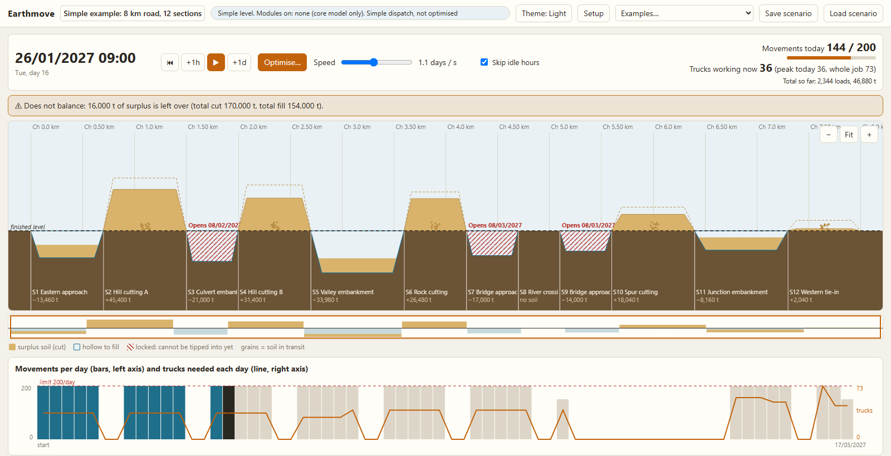
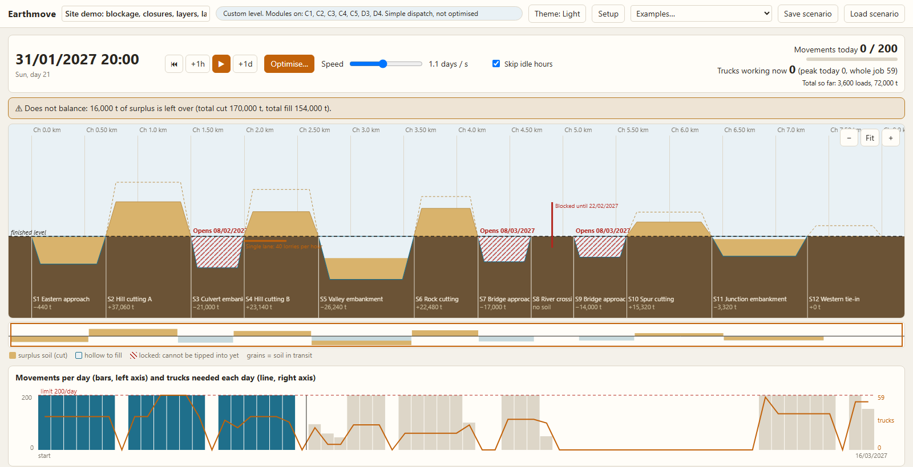
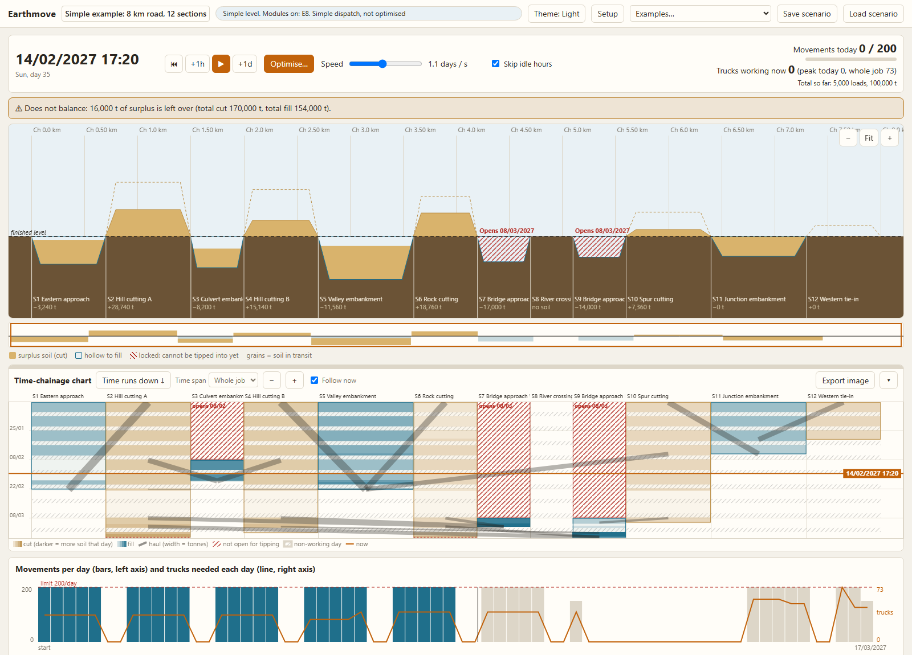
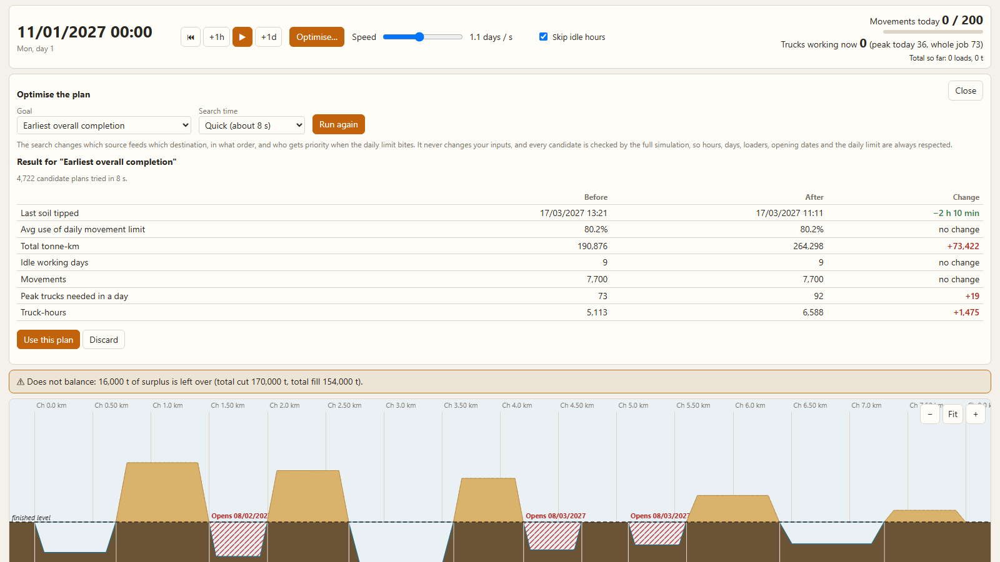
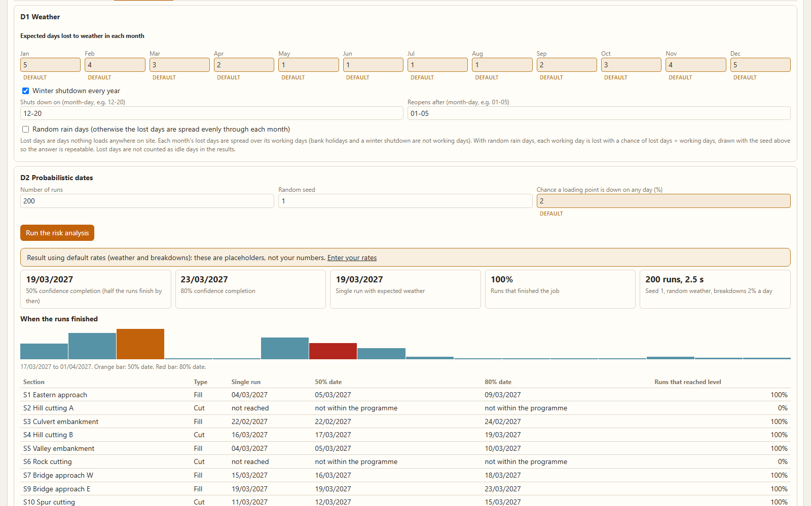

# Earthmove: earthworks haul simulator

Earthmove simulates the cut-to-fill earthworks on a linear scheme such as a road or railway, one lorry load at a time. You describe the job as a row of sections, press play, and watch the soil move from the cuttings to the embankments. It then tells you when each section reaches level, how many lorries the plan needs, and what the job costs.

**Try it online:** [intelligent-planning.com/tools/earthmove](https://www.intelligent-planning.com/tools/earthmove/)

Earthmove is one of the browser-based planning tools from [Intelligent Planning](https://www.intelligent-planning.com/tools/). Like the others, it runs entirely in your web browser. Your scenarios stay on your computer and nothing is uploaded.

> **Alpha release.** The results are planning estimates for comparing options, not a contractor's programme or a price. The cost, carbon and weather rates start as placeholders, and every result that uses one is marked until you enter your own.



## What it does

- **Simulates the haul.** Each loader fills a lorry, the lorry drives to the nearest fill that can take the soil, tips, and the next load begins. Working hours, working days, a site-wide daily movement limit and dates before which a fill cannot be tipped are all respected.
- **Shows it as it happens.** A clock, a cross-section of the road with soil in transit, a daily movements chart and a count of the lorries working.
- **Adds detail when you need it.** 29 optional modules cover soil types and bulking, fleets and vehicle types, site constraints, calendars, weather, cost, carbon and reporting. Start simple and switch on only what your job needs.
- **Finds a better plan.** The optimiser searches for a haul plan with an earlier finish, better use of the daily limit, less haulage, or lower cost or carbon, and shows the before and after side by side.
- **Tests the risk.** Run the job hundreds of times with random weather and breakdowns to get 50% and 80% confidence finish dates.
- **Exports the answers.** Results, the movement log and daily totals as CSV, a programme CSV you can import into Primavera P6 or Microsoft Project, a time-chainage chart image and a printable one-page report.

| | |
|---|---|
|  |  |
| Site constraints: a blocked haul road, a single-lane stretch and fills that open later | Time-chainage chart of the whole job |
|  |  |
| The optimiser compares its plan with simple dispatch | Weather and breakdown risk analysis |

## Getting started

1. Open [the online tool](https://www.intelligent-planning.com/tools/earthmove/), or build your own copy (below).
2. Pick an example from the **Examples** menu. The Simple example is an 8 km road with 12 sections.
3. Press play (▶). Use **+1h** and **+1d** to step through, and the speed slider to go faster.
4. Change a number in the **Sections** table or the global settings and watch the results update.
5. When you are ready, choose **Setup** to switch on the modules your job needs.

The help files explain each part in plain English:

- [Getting started](docs/getting-started.md): the screen, the five global settings, the section table and the examples
- [Modules](docs/modules.md): the four detail levels and what each of the 29 modules adds
- [Optimiser and risk analysis](docs/optimiser-and-risk.md): finding a better plan and testing it against the weather
- [Results, imports and exports](docs/results-and-exports.md): reading the results, CSV layouts, saving scenarios and reports
- [Limits and questions](docs/limits-and-faq.md): what the model leaves out, and answers to common questions

## Running your own copy

Earthmove has no dependencies and no build tools. It is plain JavaScript in `src/`, joined into one self-contained HTML file by a short Python script.

```bash
python3 build.py                # writes dist/earthmove.html
```

Open `dist/earthmove.html` straight from disk in any modern browser (Chrome, Edge, Firefox or Safari). It needs no internet connection and no server. To share it on your local network, run `python3 serve.py` (port 8090).

## For developers

- `src/engine.js` is the simulation, `src/model.js` holds the scenario defaults, validation and examples, `src/optimiser.js` and `src/risk.js` run in a Web Worker, and `src/ui.js` is the page.
- `tests/run.js` is the main test suite: numbered tests, each checked against a hand calculation written in a comment. Run it with `node tests/run.js` and expect `ALL PASSED` (578 checks).
- `tests/monotone.js` checks that removing a constraint never makes the optimised finish later (about 40 seconds).
- `DECISIONS.md` records every design decision and the reasoning behind it. Read it before changing how the simulation behaves.

The page can also be served as separate files under a strict Content-Security-Policy with no inline script, which is how the Intelligent Planning website hosts it (see decision 35).

## Licence

Earthmove is open source under the [MIT licence](LICENSE): you are free to use, change and share it, including commercially. It comes with no warranty, so check its results before relying on them.

## About

Earthmove is developed by [Intelligent Planning Ltd](https://www.intelligent-planning.com/), an independent UK planning and project controls consultancy. See our other [browser-based planning tools](https://www.intelligent-planning.com/tools/), or [get in touch](https://www.intelligent-planning.com/contact.php) with questions or ideas.
