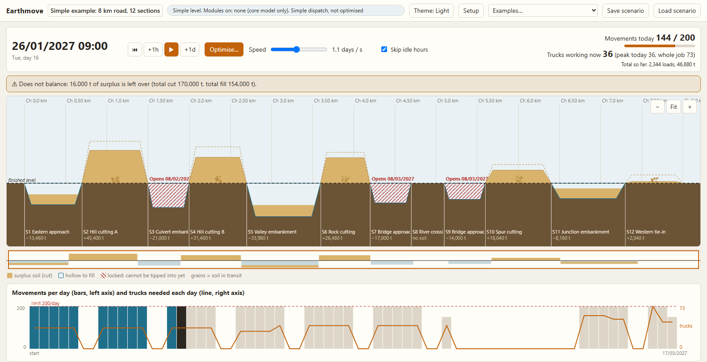

# Getting started

[Back to the README](../README.md) · [Modules](modules.md) · [Optimiser and risk](optimiser-and-risk.md) · [Results and exports](results-and-exports.md) · [Limits and questions](limits-and-faq.md)

Earthmove models one job: moving surplus soil from the cuttings on a road or railway to the embankments that need it, by lorry. This page covers the screen, the basic inputs and the examples. Everything else builds on these.

## The idea in one paragraph

The scheme is a row of sections laid end to end, west to east. Each section either has spare soil (a cut, shown as a positive quantity) or needs soil (a fill, shown as a negative quantity). During working hours, each loader at a cut fills a lorry. The lorry drives to the nearest fill that is open and still has room, tips, and the next load starts. This carries on day by day until every fill is full or there is no soil left to move. The distance for a load is measured between the middle of the two sections, and the travel time comes from the average speed.

## The screen

**Top bar.** The scenario name (click to rename it), a line saying which modules are on and whether the plan is optimised, the theme switch (light, dark or automatic), **Setup** to choose the level of detail, the **Examples** menu, and **Save scenario** / **Load scenario**.

**Play bar.** The simulation clock and day number, then:

| Control | What it does |
|---|---|
| ⏮ | Back to the start |
| +1h / +1d | Step forward one hour or one day |
| ▶ | Play and pause (or press the space bar) |
| Optimise… | Open the optimiser (see [Optimiser and risk](optimiser-and-risk.md)) |
| Speed | How many simulated days pass each second |
| Skip idle hours | Jump over nights, weekends and other times when nothing moves |

On the right you see the movements so far today against the daily limit, the lorries working now, and the totals so far.

**Messages banner.** Problems with the inputs appear here in plain English, for example when the cut and fill do not balance. Click a message to jump to the field it is about.

**Road view.** A cross-section of the whole road. Sand colour is soil above finished level (spare soil in a cutting), the pale hollows are fills still to be filled, and red hatching marks a fill that cannot be tipped into yet. The dots moving along the road are loads in transit. Use **−**, **Fit** and **+** to zoom, and click or drag the overview strip underneath to move along the road.

**Daily chart.** Bars show the movements on each day (left axis) and the line shows the lorries needed that day (right axis). Days already played are coloured and days still to come are grey.

**Tabs.** Sections, Results, Movement log and Messages are always there. Switching on modules adds tabs such as Site & calendar, Weather & risk, Cost & carbon and Mass haul.

## The five global settings

These sit at the top of the **Sections** tab.

| Setting | Meaning |
|---|---|
| Project start date | The first day of the simulation |
| Average travel speed (kph) | Used for every trip, loaded and empty, unless module B3 sets separate speeds |
| Average load (tonnes or m³) | How much one lorry carries |
| Loading time per lorry (min) | How long a loader takes to fill one lorry |
| Max movements per day (whole site) | The most loads that can leave across the whole site in one day, for example a planning condition |

**Quantities in** lets you work in tonnes or cubic metres. In cubic metres a soil density converts to tonnes (1.8 t per m³ to start with).

## The section table

One row per section, in road order from west to east. The chainage of each section is worked out from the lengths above it.

| Column | Meaning |
|---|---|
| Name | Anything you like, for example "S3 Culvert embankment" |
| Length (m) | The length of the section along the road |
| Soil | Positive for spare soil to dig out (cut), negative for soil needed (fill), zero for neither |
| Loads start from / to | The hours each day in which a load may start being loaded |
| Earliest tipping date | For a fill: no soil can be tipped before this date (for example a culvert or bridge abutment still being built) |
| Max loaders | How many lorries can be loaded at the same time in this section |
| Working days | The days of the week this section works |

If the total cut and total fill differ, the messages banner says by how much. The surplus is left in place, or goes to an off-site tip if you switch on module A4.

## The examples

Each example is a complete scenario you can play, change and save as your own.

| Example | What it shows |
|---|---|
| Simple example | An 8 km road with 12 sections and the core model only |
| Modules demo | The fleet and plant modules: a fixed number of lorries, vehicle types, speeds, receiving rates and excavators |
| Materials demo | Several soil types with rules for where each may go, bulking and compaction, an off-site import and export, and a stockpile |
| Site demo | A blocked haul road, a single-lane stretch, closed periods, layered fill and target dates |
| Risk demo | Weather, bank holidays and probabilistic finish dates |
| Commercial demo | Cost, carbon, mass haul, actual progress, programme export and reporting |
| Stockpile demo | A cut that closes before its fill opens, so soil goes through a stockpile |

Loading an example replaces the current scenario, so save your own first if you want to keep it.

## Saving your work

Earthmove keeps your current scenario in this browser automatically, so it is still there when you come back. **Save scenario** downloads it as a `.json` file you can keep, send to a colleague or load again later with **Load scenario**. Nothing is ever sent to a server.

## Handy links

You can open the tool at a particular point by adding options to the end of its web address after a `#`, joined with `&`. For example `#example=risk&tab=risk` opens the Risk demo on its Weather & risk tab.

| Option | Effect |
|---|---|
| `example=simple` (or `modules`, `materials`, `site`, `risk`, `commercial`, `stockpile`) | Load that example |
| `tab=results` (or `sections`, `log`, `messages`, `risk`, `masshaul`, ...) | Open that tab |
| `screen=setup` | Open the Setup screen |
| `t=22140` | Jump to that many minutes after the start (22140 is 09:00 on day 16) |
| `theme=dark` (or `light`, `auto`) | Choose the colour theme |
| `replay=1` | Open in replay mode for a meeting (see [Results and exports](results-and-exports.md)) |

Next: [choose the level of detail with modules](modules.md).
