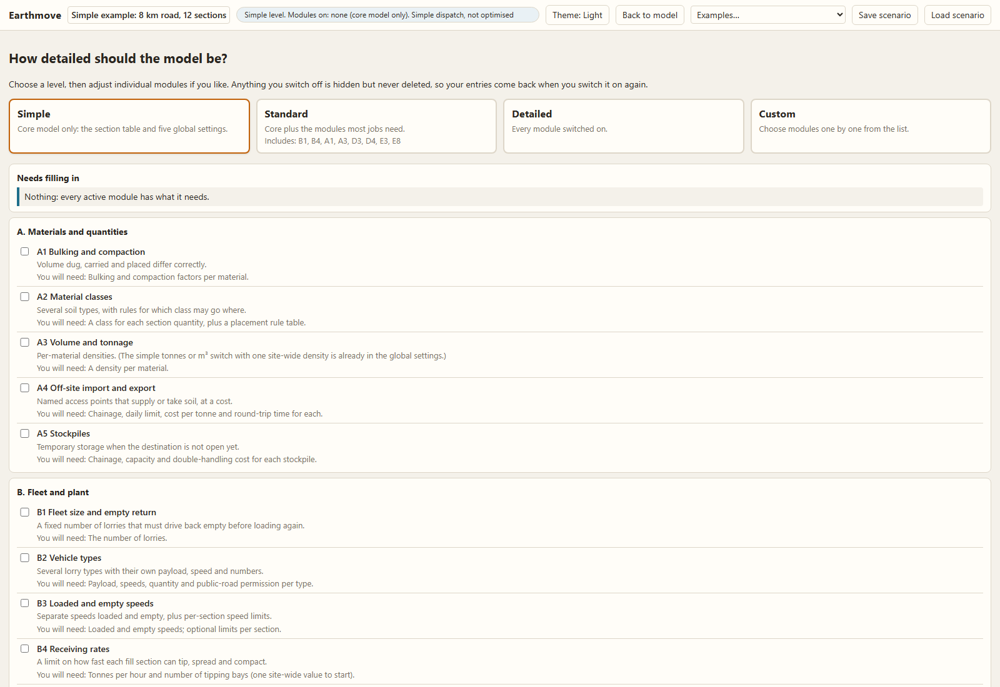
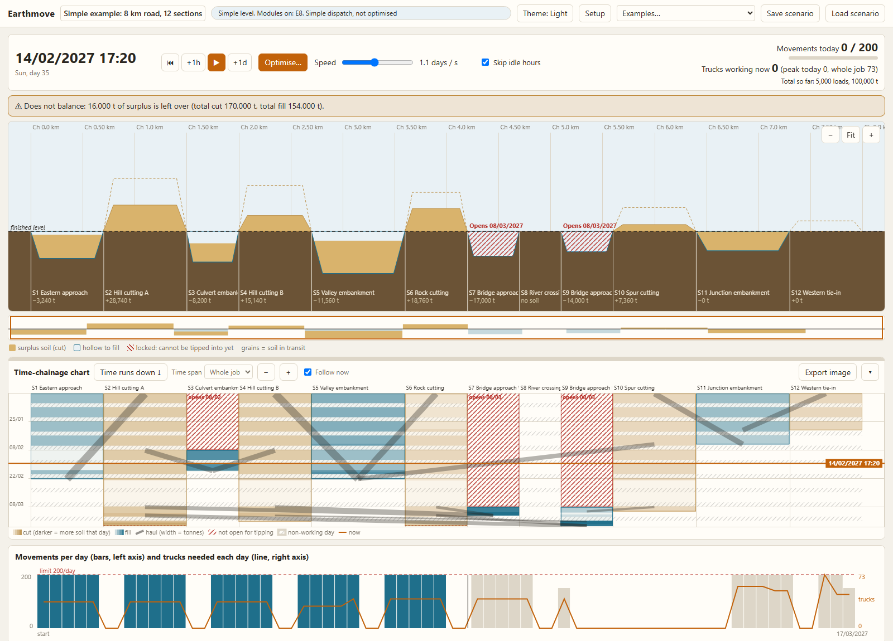

# Modules

[Back to the README](../README.md) · [Getting started](getting-started.md) · [Optimiser and risk](optimiser-and-risk.md) · [Results and exports](results-and-exports.md) · [Limits and questions](limits-and-faq.md)

The core model needs only the section table and five global settings. Everything else is an optional module, so you only fill in what your job needs. Choose **Setup** in the top bar to switch modules on and off.

## Levels

Start from a level, then tick or untick individual modules.

| Level | What it switches on |
|---|---|
| Simple | The core model only: the section table and the five global settings |
| Standard | The modules most jobs need: B1 fleet size, B4 receiving rates, A1 bulking and compaction, A3 volume and tonnage, D3 target dates, D4 calendar, E3 mass haul and E8 time-chainage chart |
| Detailed | Every module |
| Custom | Whatever you tick |

Switching a module off hides its inputs but never deletes them, so your entries come back when you switch it on again. The **Needs filling in** box at the top of Setup lists anything an active module is still waiting for.

## Where the inputs appear

| Modules | Where you fill them in |
|---|---|
| A1 to A5 | The **Materials & sites** tab, plus a soil type column in the Sections table |
| B1 to B6 | The **Fleet & plant** tab |
| C1 to C5 and D4 | The **Site & calendar** tab |
| D1 and D2 | The **Weather & risk** tab |
| D3 | A target date column in the Sections table |
| D5 | The **Scenarios** tab |
| E1, E2 and E4 | The **Cost & carbon** tab |
| E3 | The **Mass haul** tab |
| E5 | An import panel on the Sections tab |
| E6 | The **Actual progress** tab |
| E7 | Buttons on the Results tab |
| E8 | The time-chainage chart panel under the road view |

When a module uses a rate you have not set yourself (a cost, a fuel burn, a weather figure), the field is marked **DEFAULT** and a **Default rates** tab lists them all. Results that depend on a default say so, until you enter your own figures.

## A. Materials and quantities

| Module | What it adds | What you will need |
|---|---|---|
| **A1** Bulking and compaction | Volume dug, carried and placed differ correctly. | Bulking and compaction factors per material. |
| **A2** Material classes | Several soil types, with rules for which class may go where. | A class for each section quantity, plus a placement rule table. |
| **A3** Volume and tonnage | Per-material densities. (The simple tonnes or m³ switch with one site-wide density is already in the global settings.) | A density per material. |
| **A4** Off-site import and export | Named access points that supply or take soil, at a cost. | Chainage, daily limit, cost per tonne and round-trip time for each. |
| **A5** Stockpiles | Temporary storage when the destination is not open yet. | Chainage, capacity and double-handling cost for each stockpile. |

## B. Fleet and plant

| Module | What it adds | What you will need |
|---|---|---|
| **B1** Fleet size and empty return | A fixed number of lorries that must drive back empty before loading again. | The number of lorries. |
| **B2** Vehicle types | Several lorry types with their own payload, speed and numbers. | Payload, speeds, quantity and public-road permission per type. |
| **B3** Loaded and empty speeds | Separate speeds loaded and empty, plus per-section speed limits. | Loaded and empty speeds; optional limits per section. |
| **B4** Receiving rates | A limit on how fast each fill section can tip, spread and compact. | Tonnes per hour and number of tipping bays (one site-wide value to start). |
| **B5** Excavators | Loading machines with output rates, assigned to sections over time. | Machines, output rates, assignments and relocation lost time. |
| **B6** Availability | Percentage uptime per plant type, applied as lost time. | An uptime percentage per plant type. |

## C. Site constraints

| Module | What it adds | What you will need |
|---|---|---|
| **C1** Haul route blockages | Points on the road nothing can pass until an opening date. | Chainage and opening date for each blockage. |
| **C2** Single-lane stretches | Road lengths that limit lorries per hour or allow one direction at a time. | Start and end chainage, and the limit. |
| **C3** Closing dates and closed periods | Sections that close, or are shut for ecology windows or diversions. | Closed date ranges per section. |
| **C4** Layered fill | Fill placed in layers, with a waiting period between them. | Layer thickness and waiting days. |
| **C5** Public and internal movements | Separate daily limits, with the planning cap on public-road movements only. | Which movements use public roads, and the two daily limits. |

## D. Programme and risk

| Module | What it adds | What you will need |
|---|---|---|
| **D1** Weather | Lost days per month, an optional winter shutdown and random rain days. | Expected lost days per month. |
| **D2** Probabilistic dates | Many runs with random weather and breakdowns; 50% and 80% dates. | Number of runs, plus the weather and breakdown settings. |
| **D3** Target dates | A contract date per section, with late sections flagged. | A target date for each section. |
| **D4** Calendar | Shifts, bank holidays (UK defaults) and weekend working. | Holiday list and any extra working days. |
| **D5** Scenario comparison | Save named scenarios and compare two side by side. | Nothing extra. |

## E. Commercial and reporting

| Module | What it adds | What you will need |
|---|---|---|
| **E1** Cost | Hire, fuel, labour, tip fees and purchase costs; total and per tonne. | Rates for each plant type and cost item. |
| **E2** Carbon | Fuel burn and tCO₂e per scenario. | Fuel burn per plant type. |
| **E3** Mass haul diagram | Cumulative cut and fill along the chainage, updating as the sim runs. | Nothing extra. |
| **E4** Programme export | Section start and finish dates as CSV for P6 or MS Project. | Nothing extra. |
| **E5** Import | Load the section table from CSV or pasted spreadsheet cells. | A CSV in the template layout. |
| **E6** Planned versus actual | Enter real tonnages moved per day and re-forecast the finish. | Daily actual tonnages. |
| **E7** Reporting | A printable one-page summary and a client-meeting replay mode. | Nothing extra. |
| **E8** Time-chainage chart | A chart of the whole programme: chainage across, time down the page, with hauls as sloping bands. | Nothing extra. |

## A few modules in more detail

**A2 Material classes.** Give each line of soil in a section a type (for example topsoil, clay, rock), then use the placement table to say which types each fill may take. A fill always accepts its own type.

**A4 Off-site import and export.** An export only takes soil that no fill on site needs, and only once the fills that could take it are full. An import supplies only the shortfall.

**A5 Stockpiles.** When soil cannot go to a fill yet because the fill is not open, it is tipped at the nearest stockpile with room and hauled out once a fill can take it. Hauling it out again costs the double-handling charge.

**B1 Fleet size and empty return.** Without B1 the number of lorries is unlimited, and the results tell you how many the plan would need. With B1 you set the fleet, each lorry has to drive back empty before it can be loaded again, and loads wait when every lorry is out.

**C1 Haul route blockages.** Nothing can pass a blockage (an unbuilt bridge, a river, a live road crossing) before its opening date. Soil can still move on either side of it.

**C2 Single-lane stretches.** Either a limit on lorries per hour, or one direction at a time in alternating phases. Only loaded trips are delayed.

**C3 Closed periods.** While a section is closed nothing loads from it or tips into it, for example during an ecology window or a utility diversion. Lorries can still drive through.

**C4 Layered fill.** Each fill takes its soil in equal layers, and the next layer opens only after a waiting period for settlement.

**C5 Public and internal movements.** A planning cap that counts only the movements that use public roads, alongside the site-wide daily limit.

**D4 Calendar.** Shift times, weekend working and England and Wales bank holidays, worked out by the usual rules. You can edit the holiday list and add one-off days. A load may only start inside a shift, and a shift cannot run past midnight (use two shifts instead).

**E8 Time-chainage chart.** Chainage runs across the page and time runs down it. Cuts and fills are shaded by how much soil moved each day, and each haul is a sloping band whose width shows the tonnage. You can flip the direction of time, zoom, follow the clock and export the chart as a PNG image.

Next: [find a better plan with the optimiser](optimiser-and-risk.md).
