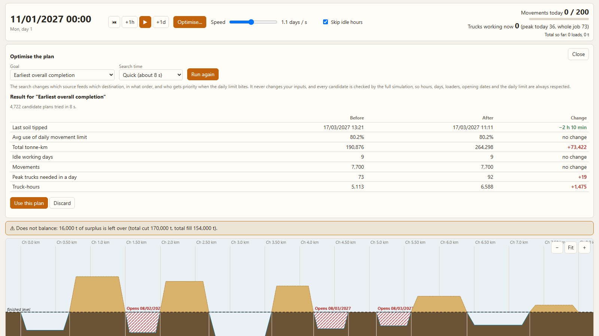
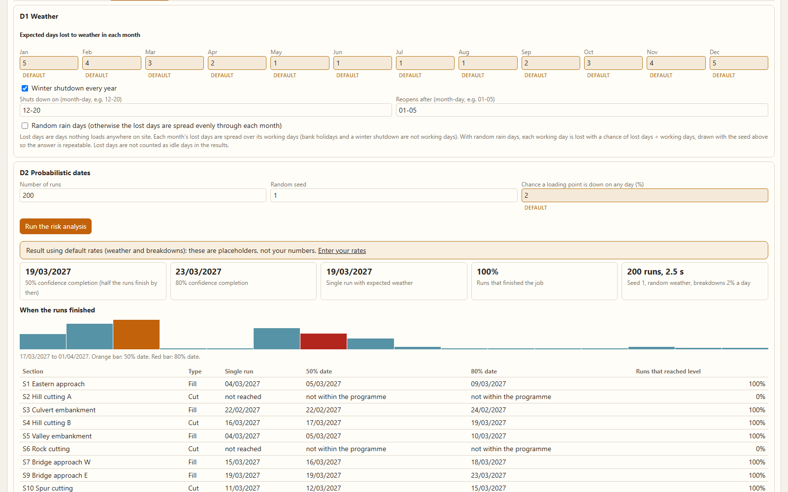

# Optimiser and risk analysis

[Back to the README](../README.md) · [Getting started](getting-started.md) · [Modules](modules.md) · [Results and exports](results-and-exports.md) · [Limits and questions](limits-and-faq.md)

## Simple dispatch

Without the optimiser, Earthmove uses **simple dispatch**: each load goes to the nearest fill that is open and still has room. This is quick to understand and close to what happens on many sites, but it is not always the best plan. Sending soil from one cutting a little further, for example, can free a nearer fill for a cutting that would otherwise wait.

The top bar always says which plan the results come from: "Simple dispatch, not optimised" or "Optimised plan".

## The optimiser

Press **Optimise…** in the play bar.

1. Choose a **goal**:
   - Earliest overall completion
   - Highest use of the daily movement limit
   - Lowest total tonne-km (the least haulage)
   - Lowest total cost (needs module E1)
   - Lowest carbon (needs module E2)
2. Choose a **search time**: Quick (about 8 seconds), Normal (about 25 seconds) or Thorough (about 90 seconds). A longer search tries more plans.
3. Press **Start**. The search runs in the background, so you can keep using the page. **Cancel and show best so far** stops it early.
4. Read the **before and after** table, then choose **Use this plan** or **Discard**.

The optimiser changes only the haul plan: which cut feeds which fill, in what order, and who gets priority when the daily limit is reached. It never changes your inputs. Every plan it tries is checked by the full simulation, so working hours, working days, loaders, opening dates and the daily limit are always respected.

Look at the whole table, not just the goal. In the example above the finish is 2 hours 10 minutes earlier, but the haul distance and the peak number of lorries go up. The best plan for one goal can be worse for another.

**After you use a plan.** The optimised plan is saved with the scenario. To go back to the simple rule, choose **Switch to nearest-available dispatch** in the optimiser panel. If you change the inputs afterwards, the plan no longer matches them, so it is not used and the page asks you to optimise again. When you do, the search starts from your previous plan. If you took a constraint away (an opening date, a blockage, a closed period), the optimiser may choose to keep working as if it were still there, and says so in the top bar. That way removing a constraint never makes the optimised finish later.

**Repeatability.** The search runs for a set time, so a faster computer tries more plans and can occasionally find a slightly different answer.

## Risk analysis

Switch on **D1 Weather** and **D2 Probabilistic dates** in Setup, then open the **Weather & risk** tab.

**D1 Weather** sets the days lost to weather in each month. A lost day is a day when nothing loads anywhere on site. You can also add a winter shutdown every year, and choose random rain days instead of spreading the lost days evenly through each month.

**D2 Probabilistic dates** runs the whole job many times (200 to start with). Each run draws its own weather and its own breakdowns (a chance each day that a loading point is down). Press **Run the risk analysis** to see:

| Result | Meaning |
|---|---|
| 50% confidence completion | Half the runs had finished by this date |
| 80% confidence completion | Four runs in five had finished by this date |
| Single run with expected weather | The ordinary simulation, for comparison |
| Runs that finished the job | Runs that moved all the soil within the programme |
| When the runs finished | A histogram of finish dates, with the 50% bar in orange and the 80% bar in red |

A table then gives the single-run, 50% and 80% dates for every section to reach level.

**The random seed** makes the analysis repeatable: the same seed always gives the same answer, so you can share a result and someone else can reproduce it. Change the seed to see how much the answer moves.

**The weather figures are placeholders.** The monthly lost days and the breakdown rate are general UK guesses, marked DEFAULT until you enter your own. Replace them with figures from your own records or the site's history before relying on the dates.

Next: [read the results and export them](results-and-exports.md).
