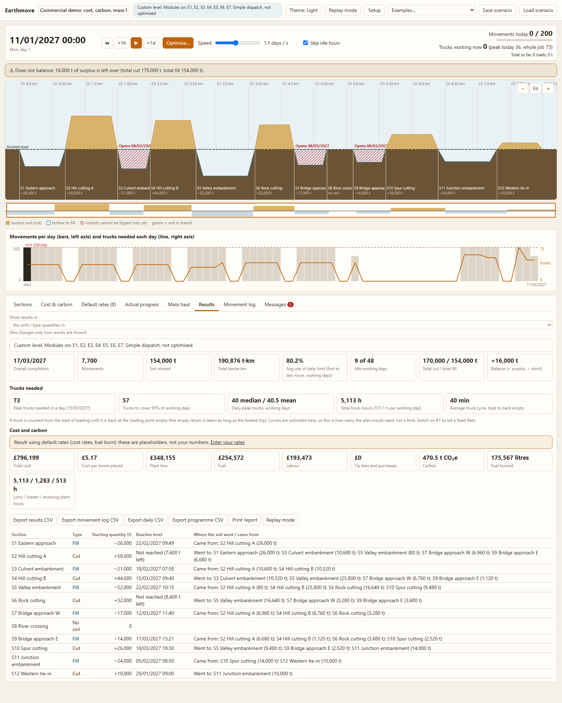

# Results, imports and exports

[Back to the README](../README.md) · [Getting started](getting-started.md) · [Modules](modules.md) · [Optimiser and risk](optimiser-and-risk.md) · [Limits and questions](limits-and-faq.md)

## The Results tab

The results always describe the whole job, wherever the clock happens to be.

**Headline figures**

| Figure | Meaning |
|---|---|
| Overall completion | When the last soil is tipped |
| Movements | The number of lorry loads |
| Soil moved | The total quantity carried |
| Total tonne-km | Each load's tonnes times the distance carried, added up. A measure of how much haulage the plan needs |
| Avg use of daily limit | How full the daily movement limit was on working days, from the first move to the last |
| Idle working days | Working days with no movements, for example while waiting for a fill to open |
| Total cut / total fill | The soil available and the soil needed |
| Balance | Positive for surplus left over, negative for fill still short |

**Trucks needed.** Unless module B1 or B2 limits the fleet, lorries are unlimited and these figures tell you how many the plan would need: the peak in a day, the number that covers 95% of working days, the median and mean daily peak, total truck-hours and the average cycle time. A lorry counts as busy from the start of loading until it is back at the loader, taking the empty return as long as the loaded trip.

**Cost and carbon** appear when modules E1 and E2 are on: total cost, cost per tonne placed, plant hire, fuel, labour, tip fees and purchases, carbon in tonnes of CO₂e, litres of fuel and plant hours.

**The section table** shows, for every section, its starting quantity, when it reaches level (or how much is left if it never does), and where its soil went or came from.

**Show results in** lets you see quantities in tonnes or cubic metres, whichever you typed the inputs in. With A1 or A3 on, results are always in tonnes, because each soil type then has its own density.

## Exports

All exports are files saved to your computer. Nothing is uploaded.

| Button | What you get |
|---|---|
| Export results CSV | The headline figures and the section table |
| Export movement log CSV | One row per load: from, to, quantity, distance, when loading started, when it left and when it tipped |
| Export daily CSV | One row per day: date, weekday, movements, quantity loaded and lorries needed |
| Export programme CSV (E4) | One activity per section, ready to import into Primavera P6 or Microsoft Project |
| Export image (E8) | The time-chainage chart as a PNG picture |
| Print report (E7) | A one-page summary for your browser's print or Save as PDF |
| Save scenario | The whole scenario as a `.json` file |

The results, movement log and daily CSVs start with a few lines beginning `#` that record the scenario name, the modules that were on and whether the plan was optimised, so a file always says where it came from. If the results use placeholder rates, that is noted too.

**Safe to open in a spreadsheet.** Any text cell that starts with `=`, `+`, `-` or `@` is written with a leading apostrophe, so a spreadsheet shows it as text instead of running it as a formula. Numbers, including negative fill quantities, are written as plain numbers.

## Programme export (E4)

One row per section that has soil, with these columns:

| Column | Notes |
|---|---|
| Activity ID | A prefix (EW to start with) and the section number, for example EW003 |
| Activity Name | The section name |
| Original Duration (days) | From the first load to the last |
| Start, Finish | UK (dd/mm/yyyy) or ISO (yyyy-mm-dd) dates, your choice |
| Percent Complete | At the end of the simulation |
| Type, Quantity (t) | Cut or Fill, and the quantity |

P6 and Microsoft Project both let you match the columns when you import a CSV: Activity ID or ID, Activity Name or Name, Original Duration or Duration, Start and Finish. If the dates depend on placeholder weather rates, a Note column says so (a comment line would break the import).

## Importing sections (E5)

Instead of typing the section table, you can load it from a CSV file or paste cells copied straight from a spreadsheet. Use **Download template** to see the layout:

| Name | Length (m) | Soil quantity (+ cut, - fill) | Loads start from | Loads start to | Earliest tipping date | Max loaders | Working days |
|---|---|---|---|---|---|---|---|
| Cutting A | 600 | 12000 | 07:00 | 19:00 | | 2 | Mon-Fri |
| Embankment B | 800 | -12000 | 07:00 | 19:00 | 08/03/2027 | 2 | Mon-Fri |

The import is forgiving:

- Commas, semicolons or tabs between columns all work.
- Common column names are understood ("Section", "Length", "Quantity", "Start", "Loaders", "Days" and so on). With no header row, the template order is assumed.
- Numbers can have thousands separators (1,200). Times can be 7:00 or 07.00. Dates can be 8/3/27, 08/03/2027 or 2027-03-08.
- Working days can be Mon-Fri, Mon-Sat, every day, a list such as "Mon, Tue, Wed", or seven digits such as 1111100.

Before anything changes, every problem is listed with its row number in plain English. You then choose to replace the table or add the rows to the end of it.

## Actual progress (E6)

Enter the quantity actually moved each day. The Actual progress tab compares it with the plan, shows the running difference, and re-forecasts the finish from what has really happened.

## Comparing scenarios (D5)

Save named versions of the scenario on the Scenarios tab and compare any two side by side, for example with and without a haul road bridge.

## Report and replay mode (E7)

**Print report** builds a one-page summary (title, scenario, the modules that were on, key results, charts and the section table) and opens your browser's print window. Choose "Save as PDF" there to keep a copy.

**Replay mode** hides every editing control, so you can play the simulation in a client meeting without anyone seeing the input tables. Press **Exit replay mode** in the bottom corner to get the controls back.

Next: [limits of the model, and common questions](limits-and-faq.md).
